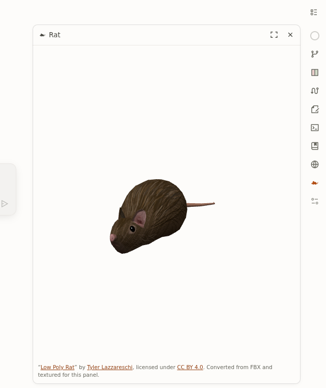

# Rat

Rat is a small demo extension for [OpenChamber](https://openchamber.dev). It
adds a **Rat** entry to the application's rail. The entry opens a Rail panel
in which the [Low Poly Rat](https://sketchfab.com/3d-models/low-poly-rat-dd63402df69742e39e989801f282e58a)
model by [Tyler Lazzareschi](https://sketchfab.com/tylerlazzareschi) turns
slowly in 3D.



- The panel follows OpenChamber's light and dark themes.
- It works offline: the renderer, the model and its textures are all inside
  the extension.
- The camera is fixed. There are no controls or settings.
- The model credit stays visible below the scene.

Rat is an OpenChamber extension, not an OpenCode plugin. It was built and
tested against **OpenChamber web 2.3.3**.

## Install from Git

1. In OpenChamber, open **Settings → Extensions**.
2. Paste `https://github.com/m3nowak/och-plugin-demo.git` into the
   **Folder, ZIP, or URL** field and press **Add**.
3. Close Settings and click **Rat** on the rail.

The repository includes the prebuilt panel and its dependency notices. Git
installation does not require Node.js, npm, or a build. The root `package.json`
is the extension manifest; installing only the source files is not enough.

## Install the prebuilt ZIP

You do not need a development toolchain for this.

1. Download [`dist/rat-1.0.0.zip`](dist/rat-1.0.0.zip) from this repository.
2. In OpenChamber, open **Settings → Extensions**.
3. Under **Add**, click the archive icon in the **Folder, ZIP, or URL** field
   (*Browse ZIP archive*) and choose the ZIP. Alternatively, type the ZIP's
   path on the OpenChamber server into the field and press **Add**.
4. **Rat** appears under **Installed** as `ZIP · v1.0.0`. It asks for no
   permissions.
5. Close Settings and click the rat icon on the rail. Click it again to close
   the panel.

OpenChamber copies a ZIP install into its own data folder, so you can delete
the downloaded file afterwards.

## Put the panel on the right

OpenChamber decides where a Rail panel docks, and Rat does not override it.
In OpenChamber web 2.3.3, Rat opens in the right-hand zone by default. To move
it, right-click the Rat icon on the rail and choose **Move panel to the
right**, **to the left** or **to the bottom**. If the panel is closed after
the move, click the icon to open it in its new place. **Configure panels** at the bottom of the rail shows, hides
and reorders rail entries.

## Build from source

Requirements: Node.js 24.14 or later and npm.

```bash
npm ci            # installs the locked dependencies
npm run package   # builds build/rat/ and writes dist/rat-1.0.0.zip
```

`npm run build` skips ZIP packaging. The build reads the original artwork
archive from `assets/low-poly-rat.zip` and checks its SHA-256 before using it.
It converts the model and bundles everything into `build/rat/panel/main.js`;
see [NOTICE.md](NOTICE.md) for what the conversion changes. npm needs network
access for `npm ci`. Nothing else is downloaded, and the extension never goes
online at runtime.

Both build commands also refresh `extension/panel/main.js` and
`THIRD_PARTY_LICENSES.txt` for Git installation. Commit those generated files
with source changes and the rebuilt ZIP. The root `package.json` is the single
manifest source; the build generates the ZIP's manifest with shorter asset
paths and without development scripts or dependencies.

Packaging is deterministic: the same sources give a byte-identical ZIP.
`npm run verify:clean-build` clones the committed repository into a temporary
folder, runs `npm ci` and packages it there. It then checks the result against
the committed ZIP, Git bundle and dependency notices.
Run it after committing all generated files and before pushing. Unlike the
acceptance tests, it checks committed files rather than working-tree changes.

### Install from a local folder

After `npm run build`, open **Settings → Extensions**, type the absolute path
of `build/rat` into the **Folder, ZIP, or URL** field and press **Add**. The
path must exist on the machine that runs the OpenChamber server. A folder
install runs straight from that folder. After rebuilding, reload OpenChamber
to load the new `panel/main.js`.

## How it works

- The root `package.json` is the manifest. It declares OpenChamber
  `apiVersion` 1, a `rat` panel named "Rat" with the icon `icon.svg`, and the
  entry `panel/index.html` under `extension/` for Git installs, or at the ZIP
  root. It requires OpenChamber 2.3.3 or later and asks for no capabilities.
- `src/panel/main.ts` is the whole panel. esbuild bundles it into one classic
  (IIFE) script, as OpenChamber requires, together with three.js, the
  OpenChamber SDK, the model's vertex data and its two PNG textures as
  `data:` URLs. The panel's sandboxed frame therefore loads only
  `index.html` and `main.js`.
- **Theme:** the SDK's `onReady` snapshots carry the host theme, including
  later changes, and `applyHostReady` turns them into CSS variables. The
  canvas is transparent, so the panel background is the host's.
- **Animation:** the rat turns once every 20 seconds, also when the system
  asks for reduced motion. OpenChamber keeps a closed Rail panel's frame
  mounted, invisible but partly on screen, and does not tell the extension.
  So Rat stops its animation loop whenever any part of its scene is clipped
  or out of view, and whenever the page is hidden. It frees its WebGL
  resources when the frame unloads.
- **Errors:** without WebGL, or if the embedded model cannot be decoded, the
  panel shows a short message instead of the scene and keeps the attribution.
  It does not retry.

## Tests

The acceptance tests install the packaged ZIP and a clean Git checkout into
real OpenChamber hosts and drive them with Chromium. The Git test uses a
temporary repository and an isolated Git URL rewrite, without contacting a
remote, installing dependencies, or building inside the checkout. Each suite
starts its own OpenChamber with a temporary home and data folder on a free
loopback port. Your own instance and its extensions are not touched.
The Git snapshot includes current non-ignored working-tree files, including
new files, so the test can run before a commit. It does not test GitHub's
current branch; Git URL users receive the fix only after all changes are
committed and pushed.

```bash
npx playwright-core install chromium-headless-shell   # once
npm run typecheck
npm test
```

Prerequisites and settings:

- `openchamber` 2.3.3 on `PATH`, or set `OPENCHAMBER_BIN`.
- `RAT_TEST_CHROMIUM` uses another Chromium executable instead of Playwright's
  headless shell.
- `RAT_TEST_BROWSER_ARGS` replaces the default `--use-angle=gl-egl`. That flag
  renders WebGL through the system's EGL driver. Chromium's built-in software
  renderer (SwiftShader) crashed the GPU process on the machine where the
  tests were written.
- `RAT_TEST_ZIP` tests a different ZIP than `dist/rat-1.0.0.zip`.
- When a scene check fails, its screenshot is saved under
  `$TMPDIR/rat-acceptance/`.

[docs/acceptance.md](docs/acceptance.md) records the platform, the checks
performed and what was not tested.

## License

The extension's original code and documentation are under the
[MIT License](LICENSE). The Low Poly Rat artwork is **not**: it is © Tyler
Lazzareschi under [CC BY 4.0](https://creativecommons.org/licenses/by/4.0/).
[NOTICE.md](NOTICE.md) gives the attribution and the changes made to the
artwork. three.js and the OpenChamber SDK are bundled under their MIT
licenses, reproduced in `THIRD_PARTY_LICENSES.txt` inside the built
extension.
